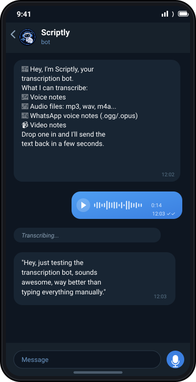

<p align="center">
  
</p>

<h1 align="center">Scriptly</h1>

<p align="center">
  A Telegram bot that transcribes voice notes, audio files, and video, including
  WhatsApp-style <code>.ogg</code>/<code>.opus</code> files, using the Groq Whisper API.
</p>

<p align="center">
  
</p>

How it works: any audio/video message the bot receives is downloaded, converted to
mp3 with `ffmpeg` (this normalizes every input format), and sent to Groq's
Whisper API for transcription. The reply is the transcribed text.

## Try the live bot

[@kucha_transcription_bot](https://t.me/kucha_transcription_bot) on Telegram.

This is my own personal instance, running on my machine, not a hosted service.
It only responds while I actually have it running, so if it doesn't reply, it's
just offline at the moment, not broken. Run your own copy with the steps below
if you want something that's always available.

## Run it yourself

### 1. Prerequisites

- Python 3.10+
- `ffmpeg` on your PATH

Install ffmpeg on Windows (pick one):

```bash
winget install ffmpeg
```

```bash
choco install ffmpeg
```

Verify it's on PATH (restart your terminal first if you just installed it):

```bash
ffmpeg -version
```

### 2. Get your keys

- **Telegram bot token**: message [@BotFather](https://t.me/BotFather) on Telegram,
  send `/newbot`, follow the prompts, copy the token it gives you.
- **Groq API key**: sign up free at [console.groq.com](https://console.groq.com) →
  API Keys → Create key.

### 3. Setup

```bash
python -m venv .venv
.venv\Scripts\activate
pip install -r requirements.txt
```

Copy `.env.example` to `.env` and fill in your two keys:

```bash
copy .env.example .env
```

### 4. Run it

```bash
python bot.py
```

Leave it running in this terminal (e.g. in a VS Code integrated terminal), open
Telegram, find your bot, send `/start`, then send it a voice note or audio file.


## Notes

- The bot only keeps audio in a temp directory for the duration of one request.
  Nothing is stored permanently.
- `GROQ_MODEL` in `.env` can be swapped to `whisper-large-v3` for max accuracy
  (slower) instead of the default `whisper-large-v3-turbo` (fast).
